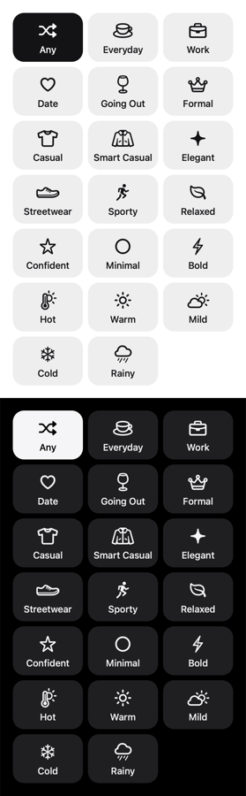

# KIPS icon language

How KIPS draws its in-app icons, so new ones look like they were always there. The reference set is Build My Look's
question answers (build 12): bold outline objects, one ink color, on a soft tile.



Scope: icons inside the app (buttons, tiles, rows, empty states). Not the app icon or logo (`docs/design/app-icon/`,
`docs/design/logo/`), and never garment images (CLAUDE.md: no tints, filters or glows on garments).

## The look in one line

**A real, everyday object, drawn as a bold outline in one color, centered on a quiet tile, always with a word under it.**

## Rules

### 1. Source: SF Symbols, through `Icon`
- Every icon is an Apple SF Symbol drawn by `mobile/src/components/Icon.tsx`. It matches the iOS system font in
  weight and optical size, stays sharp at any size and follows dark mode for free.
- Each entry also names an **Ionicons outline** fallback (only used off iOS). Pick the closest `*-outline` glyph.
- **Not used:** emoji, 3D or clay renders, illustrations, AI-generated images, hand-drawn SVGs, other icon packs,
  colored or multicolor symbols. If SF Symbols has nothing close, see rule 7 before inventing anything.

### 2. Outline, not filled
- Use the plain symbol name (`heart`, `briefcase`, `cloud.rain`), not `.fill`, `.circle` or `.square` variants.
- Filled variants are reserved for status: `check` (`checkmark.circle.fill`) for done, `plusCircle` for the add
  action, and the selected tab in the tab bar (`homeFill`, `closetFill`, `accountFill`, the iOS convention). A few shapes are solid by nature (`sparkle`, `snowflake`, `figure.run`); that is fine, as long as no
  outline version exists.

### 3. Weight follows the role
| Role | Size | Weight | Example |
|---|---|---|---|
| **Choice icon**: an answer the user picks (option tiles) | 24pt | `semibold` | Build My Look's Occasion, Style, Vibe, Weather |
| Feature/empty-state glyph | 22–32pt | default | `photos` 28 in First Pieces, `garment` 32 placeholder |
| Inline with text (buttons, rows, banners) | 14–20pt | default | `Button` icon 18, row `chevron` 14 |
| Decorative figure | 100–200pt | default | `person2` in `separatorStrong` on Add and Intro |

The bold "language" the owner approved is the **choice icon** row: new pickable answers (filters, preferences,
quiz-like questions) use 24pt semibold. Don't make inline or navigation icons bold.

### 4. One color, taken from the text
- An icon is the same color as the label beside it: `colors.label` normally, `colors.background` when its tile is
  selected (ink fill, inverted content), `colors.secondaryLabel` / `tertiaryLabel` for quiet accessories,
  `colors.tint` for actions, `colors.destructive` for errors.
- Never a second color, gradient, shadow, glow or per-icon accent. Color meaning comes from the theme tokens only.

### 5. Literal objects people already know
- Show the thing, not the idea: Work = briefcase, Everyday = coffee cup, Going Out = wine glass, Cold = snowflake,
  Streetwear = sneaker. A user should guess the word from the icon alone.
- Prefer objects from daily life and clothing over abstract shapes. Abstract shapes (`circle` for Minimal, `bolt`
  for Bold) are a last resort for words that are themselves abstract.
- **Siblings must differ at a glance.** In one question, two answers can't share a silhouette. Hot was first
  `sun.max` next to Warm `sun.min`; they read as the same sun, so Hot became `thermometer.sun`. Render the whole
  group together (rule 9) and look for twins.

### 6. Reserved meanings
Some symbols already mean one thing in KIPS; don't reuse them for something else.

| Symbol | Means | Where |
|---|---|---|
| `sparkles` | AI generation / Build My Look entry | Home |
| `shuffle` | "Any / no preference" | first answer of every Build My Look question |
| `checkmark`, `checkmark.circle.fill` | selected / done | pickers, capture results |
| `exclamationmark.circle` | a problem to look at | errors, banners |
| `camera`, `photo.on.rectangle` | take a photo / pick from Photos | Add flows |
| `tshirt`, `hanger`, `jacket`, `shoe`, `handbag` | garments and closet | closet, placeholders, Style |
| `chevron.right`, `chevron.left`, `xmark` | go deeper / back / close | navigation |

### 7. When no symbol fits
1. Search SF Symbols for the nearest **object** (there is no bow tie, so Formal is `crown`).
2. If the answer is about **color**, show the colors themselves: three overlapping 20pt swatches (Colors question),
   never a palette icon.
3. If the answer is a **garment the user owns**, show their garment image, not an icon.
4. Only then raise a custom SVG with the owner; it must match SF Symbols' semibold stroke and rounded joins.

### 8. Always with a word
- An icon helps people choose faster; the label carries the meaning. Every choice icon has its label under it,
  15pt medium (`type.subhead`, weight 500), one line (shrinks to fit, e.g. "Smart Casual" on an iPhone SE).
- Icon-only controls (close, back) need an `accessibilityLabel`. Icons inside a labelled control add no label of
  their own.

### 9. The tile it sits on
Choice icons live on `OptionTile` (`mobile/src/components/outfitBuilder/OptionTile.tsx`):
- Three per row, 8pt gaps, 20pt screen margins, 78pt tall, radius 18 (`radius.list`), `colors.fill` background.
- Icon centered in a 26pt slot, 8pt above the label.
- Selected: ink fill (`colors.label`) with inverted icon and label, like `Chip`.
- Motion: press scales to 0.97 (`PressScale`); becoming selected pops the icon from 80% with a light spring and a
  selection haptic. Under Reduce Motion the pop is skipped; the haptic stays.

## Adding an icon

1. **Pick** the SF Symbol by the rules above. Check the name exists in the app's typings:
   `grep "'sun.max'" mobile/node_modules/sf-symbols-typescript/dist/index.d.ts`
2. **Preview** it with its siblings, light and dark, the way the app draws it:
   ```bash
   swift scripts/icon_sheet.swift /tmp/icons.png "Hot=thermometer.sun" "Warm=sun.max" "Cold=snowflake"
   ```
   It prints `MISSING` for a name this Mac doesn't know. Share the image with the owner before wiring it in.
3. **Add** it to `ICONS` in `Icon.tsx`, keyed by what it means in the app (`coffee`, `hot`), with an Ionicons
   `*-outline` fallback; group related entries under a short comment.
4. **Use** it with the role's size and weight (rule 3) and the label's color (rule 4).
5. **Check**: `cd mobile && npx jest && npx tsc --noEmit` (a wrong SF or Ionicons name fails `tsc`), then look at it
   on a phone in light and dark mode.

## Checklist for a new icon
- [ ] SF Symbol, outline variant, with an Ionicons outline fallback
- [ ] Real, familiar object; guessable without its label
- [ ] Different silhouette from every sibling in its group
- [ ] Not a reserved symbol used for another meaning
- [ ] Size and weight match its role; one color from the theme
- [ ] Has a visible label (or an accessibility label if icon-only)
- [ ] Previewed light and dark with `scripts/icon_sheet.swift`; owner approved
