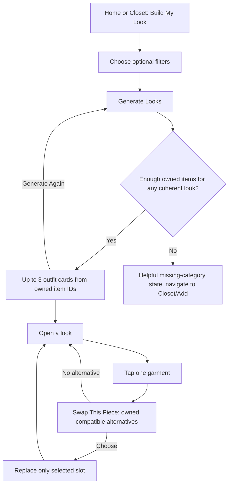

# Product Requirements Document — AI Outfit Builder MVP

**Status:** Draft for approval | **Date:** 2026-10-29 | **Working name:** Build My Look

## 1. Product summary

The user has digitized some/all of their clothes. They want practical outfit ideas **made solely from garments they actually own**. Build My Look lets them optionally specify an occasion, style, mood/vibe, manual weather preference and color preference, then see **up to three coherent suggestions**, inspect each look and **swap a selected garment for another owned garment**.

The product does not try to learn their personality, predict the weather, maintain an outfit diary or sell them clothes. It uses existing wardrobe catalog assets; it does **not** create new look images using generative image models.

## 2. User problem

An inventory is helpful but passive. A user still has to decide what to combine. A useful first recommendation feature turns uploaded wardrobe items into an actionable outfit without the user having to browse every category or learn styling vocabulary.

## 3. Value proposition

> “Tell us what you're dressing for. We'll put together looks using only what's already in your closet.”

User outcomes:
1. Get plausible outfit ideas without leaving the app.
2. See the exact pieces they own, in their own catalog photographs.
3. Quickly fix a suggestion by exchanging one piece without redoing all other choices.
4. Make useful progress even with a partially filled closet (where structurally possible).

## 4. Persona / key jobs to be done

- “I'm going to work and want something smart but relaxed.”
- “It's hot today; suggest something suitable from my closet.”
- “I like the outfit, but I'd rather wear a different pair of pants.”
- “I want a bolder outfit for tonight without buying something new.”

The user owns the selected garments; they are not shopping suggestions. No assumptions about gender, size, body type, age, lifestyle or fashion identity.

## 5. In scope (MVP)

- A **new route/screen** accessible from existing Home or Closet navigation. Final location must be chosen based on current app UX.
- Single lightweight filter form:
  - `Occasion`: Any, Everyday, Work, Date, Going Out, Formal.
  - `Style`: Any, Casual, Smart Casual, Elegant, Streetwear, Sporty.
  - `Vibe`: Any, Relaxed, Confident, Minimal, Bold.
  - `Weather`: Any, Hot, Warm, Mild, Cold, Rainy (**manually selected, not inferred**).
  - `Colors`: Any, Neutral, Colorful, Dark, Light (optional/advanced).
- User may choose no explicit filters and still generate (default `Any`), if a viable outfit exists.
- On-demand generation of **up to 3 different looks**, represented by existing garment IDs and catalog images.
- Lightweight name and one-sentence rationale per look; explanation must reflect actual submitted input and actual selected pieces.
- Look detail/edit screen. Tap a garment → `Swap This Piece` → ranked owned alternatives (same slot by default) → choose replacement → updated look appears without altering other slots.
- Useful loading, empty closet, insufficient category coverage, no-alternative, AI unavailability and invalid-result fallbacks.
- Private and account-bound access; server validation of every selected ID.
- Basic instrumentation for quality and performance, with no preference-learning loop.

## 6. Explicitly out of scope

- Weather API/forecast, GPS, weather permissions or automatic weather assumptions.
- Cross-session preference learning, inferred permanent taste profile, ML training, persistent user feedback scoring.
- Outfit calendar, what-I-wore diary, outfit history, saved outfits/bookmarks, look sharing.
- Image generation or images of user wearing a combined look; no virtual try-on.
- Shopping suggestions, external catalog garments, product recommendations, affiliate links.
- Chat-based stylist and natural-language free-text input as the primary UX.
- Push reminders, proactive daily outfits, notifications.
- Persisting generated look compositions or swaps across sessions; all proposals are transient.
- Refactoring the image generation pipeline, item-generation billing, or the onboarding capture flow.

## 7. Primary user flow

## 8. UX/product rules

1. **Ownership invariant:** Every recommended/swap garment is an active item currently belonging to the authenticated user. Reject wrong-user, deleted, unready or stale IDs.
2. **No hallucinated items:** Never use imagery, text, or IDs representing clothes outside the user's closet. Don't substitute generic product photos into real proposals.
3. **Up to three, not exactly three:** If only one or two distinct valid looks exist, show them. Don't duplicate or invent a third.
4. **Whole outfit where possible:** Prefer structurally wearable combinations (e.g. top + bottom, or a one-piece). Footwear and outerwear are optional when not available; state clearly if a look is incomplete rather than implying missing owned pieces.
5. **Manual weather:** Weather is just the user's declared scenario. `Rainy` indicates wet conditions but **does not imply a temperature**.
6. **Meaningful diversity:** Avoid returning three nearly identical combinations. Try a different anchor item/silhouette/style while honoring strong user constraints.
7. **Swap is local to one selected slot:** Keep other parts of the look fixed. Replacement must pass ownership + compatibility validation. Do not silently replace an entire outfit.
8. **User can override style:** Rank compatible alternatives and offer a `Browse more from my closet` option. The app can make suggestions without enforcing subjective fashion opinions as hard prohibitions.
9. **No back/360 generation, no paid image action:** Existing catalog images are rendered together as UI cards/collage.
10. **No permanently stored feedback:** `Generate Again` and `Swap` affect only the current on-screen look. Aggregate telemetry is not a personalization database.
11. **Insufficient clothes:** Never pretend there is a full look when structural essentials are absent. Show exactly what's missing and provide a direct Add Clothes action.
12. **Errors:** Return user-friendly recoverable states, including on slow or failed AI calls; keep any valid existing recommendations visible.

## 9. Entry and eligibility

Recommended entry: `Build My Look` action/card visible in Home or Closet, discoverable even when the closet is too small. If no viable combinations exist, action should open an educational empty state rather than producing a fake look. No new tab required in MVP.

The normal wardrobe grid and Add flow remain unchanged. Do not tie release to the First 3 Pieces Onboarding feature being completed.

## 10. Quality bars / acceptance

- Given a wardrobe with a viable top and bottom, user can request and inspect a look.
- With a sufficiently varied wardrobe, return up to three distinct suggestions, no third result manufactured merely to fill UI.
- Choosing `Hot` meaningfully decreases heavy outerwear/knits unless data is insufficient; selecting `Formal` prioritizes appropriately formal combinations. Unknown metadata is treated cautiously and does not lead to false certainty.
- An item tapped in a look displays **only compatible options from that account**; replacing it leaves all other item IDs unchanged.
- If a garment is deleted or moved between suggestion and swap, server blocks invalid replacement and UI offers a refresh.
- With no viable outfit, display a helpful next step rather than a broken Generate control.
- Every output ID is validated after any AI call; no untrusted model text treated as truth.
- Responsive small-screen accessible UI; VoiceOver tappable garment labels and loading status.

## 11. Success measurement (initial hypotheses, not validated targets)

- `look_builder_opened` → `look_generation_requested` conversion.
- % requests yielding >=1 server-validated coherent look.
- Generation P50/P90 latency, AI token/cost spend per request, error rate.
- % generated sets where user opens a look.
- `% look_detail_views with a swap` and `% swap sheets leading to a replacement`.
- Optional anonymous study: “Would you wear this outfit?” / preference against curated manual baseline.

No long-term preference profiles or wear history in analytics; keep event payloads ID-free or pseudonymous and avoid garment images/URLs or free text.

## 12. Open choices / recommendations

| Decision | Suggested default | Status |
|---|---|---|
| Which entry surface? | Prominent Home/Closet entry; no fifth tab | UX review |
| Save outfit to wardrobe? | No, future release; transient only | Out of scope for MVP |
| Charge credits for recommendations? | **No credits in beta**, rate-limited server side | **Pricing approval needed** |
| LLM for reranking? | Optional Gemini metadata-based scorer on shortlisted candidates, deterministic fallback | Engineering audit |
| Weather UI granularity? | One simple manual choice; `Rainy` with unknown temperature | UX review |
| What if wardrobe has too few categories? | Helpful partial coverage/empty-state; never invent items | Product rule |
| Should metadata enrichment happen on every call? | No: reuse existing data; conservative derived labels/cache where justified | Engineering audit |

## 13. Rollout

Feature flag. Test against anonymized/demo fixtures and willing beta users. Start with internal validation, then a few friends/family, and only make the entry point prominent after outfit quality and costs are acceptable. This is a new recommendation feature and should **not block the existing TestFlight launch**.