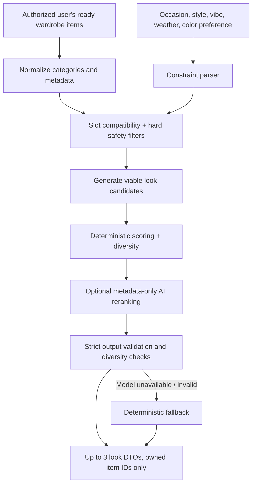

# Recommendation Engine — Implementation Design Brief

**Status:** Proposed technical architecture, not verified against current code.  
**Goal:** Generate usable outfits from the authenticated user's actual wardrobe, given their explicitly selected filters, and support fast item replacement.

## 1. Why a hybrid engine

A general-purpose LLM should **not** freely invent outfits from the internet or propose IDs from an unrestricted wardrobe. We want structural and ownership guarantees from the backend and use AI only when it contributes style judgment.

Preferred pipeline:



**Recommended V1:** candidate builder/rule filters + heuristic scorer, optional Gemini reranker for shortlisting/explanations. LLM is not a dependency for ownership enforcement or the basic ability to show suggestions.

## 2. Item metadata — minimal viable taxonomy

Wardrobe items are likely to have broad categories and front catalog images. The audit must inspect actual schema; do not assume these fields exist yet.

| Field | Type | Why needed | Fallback |
|---|---|---|---|
| `item_id` | stable, server-owned | Reference exact clothing item | mandatory |
| `owner_id` | server-authenticated | tenant isolation | mandatory; never let model choose owner |
| `image_ref` | private storage reference | display actual owned catalog photo | mark unrenderable if absent |
| `category` | existing enum | broad classification | map conservatively |
| `slot` | top/bottom/one_piece/outerwear/footwear/unknown | construct outfits | compute from category/subtype; unknown excluded from structural assembly |
| `subtype` | shirt/t-shirt/jeans/skirt/dress/etc. | accurate slot and matching | infer only if credible; otherwise `unknown` |
| `colors` | list / dominant color | harmony and user color preference | unknown = neutral for constraints, not fabricated |
| `formality` | casual/smart/formal/unknown | occasion match | unknown soft penalty |
| `warmth` | lightweight/midweight/heavy/unknown | manual-weather fit | unknown soft penalty |
| `style_tags` | sparse optional tags | vibes and style fit | empty/unknown |
| `status` | saved/ready/not ready/deleted | exclude non-usable items | require accessible, active, ready |
| `metadata_confidence` | optional, per field | avoid overconfident fabric/warmth rules | no hard exclusion based only on speculative labels |

Important taxonomy difference: a **dress** is `one_piece`, a **skirt** is `bottom`; the generic `Dresses & Skirts` UI category is not enough by itself. Coats/jackets may belong to `outerwear`, but cardigans/shirts can require clearer subtype treatment. Never guess with high certainty.

If shoes are not supported/owned, create structurally useful two-piece looks and **do not synthesize shoes**. If a full look truly requires data absent from the wardrobe, mark incomplete appropriately.

### Enrichment policy

1. Reuse item metadata already produced by garment detection/storage.
2. Add simple deterministic mappings (e.g. known `jeans` → `bottom`).
3. For unknown subtype/material, leave unknown and avoid silently excluding the item if a plausible structural category is known.
4. An **optional** one-time incremental metadata enrichment process can be proposed after audit, but it must not add hidden user-credit charges or large new provider spend.
5. Do not call a vision model over the full wardrobe on every suggestion request. No new generated outfit assets.

## 3. User filter semantics

- **Occasion** (Any/Everyday/Work/Date/Going Out/Formal): preferred dress code and formality context. Treat `Formal` as strong preference, but offer a clear insufficient-match error if wardrobe can't satisfy it.
- **Style** (Any/Casual/Smart Casual/Elegant/Streetwear/Sporty): preferred styling direction.
- **Vibe** (Any/Relaxed/Confident/Minimal/Bold): soft aesthetic signal, not a factual property.
- **Weather** (Any/Hot/Warm/Mild/Cold/Rainy): **manual scenario only**. Rainy means precipitation risk; no implicit temperature, no API call, no GPS.
- **Colors** (Any/Neutral/Colorful/Dark/Light): broad palette preference, not a demand that all garments be identical in color.

Strong requirements: only owned items; no duplicate item within same look; valid outfit structure. Manual-weather `Hot` should strongly down-rank heavy layers; `Cold` should prefer outerwear or warmer pieces when present. Never assert a garment is waterproof based on apparent material alone; rainy options should be cautious.

## 4. Build candidate combinations

Base slot templates (choose among supported types):

- `top + bottom` (common minimal complete outfit)
- `top + bottom + outerwear`
- `one_piece`
- `one_piece + outerwear`
- Optionally append `footwear` to any of the above if footwear exists in the user's wardrobe.

No shoes, jewelry, bags, coats, etc. may be invented when not present. If only tops exist, no `top + top` fabricated as a complete look. Treat outfits with a one-piece garment structurally differently from top+bottom. Exclude same item repeated in two slots.

**Candidate budget:** Enumerating all wardrobe cross-products becomes expensive for hundreds of items. Use bounded top-K per category, beam search, or stratified sampling to create a manageable diverse candidate pool. The internal candidate budget is an operational performance setting, **not a cap on how many clothes the user may store**. Ensure the selection stays diverse across anchors, silhouettes and colors. Exact limits (e.g. top 10 per slot / max 100 candidates) should be benchmarked, not locked in prematurely.

## 5. Hard vs soft constraints

**Hard checks** (must pass before display):

- All garment IDs in this authenticated user's active and renderable wardrobe.
- Compatible slot structure; no duplicate item within one outfit.
- Item has enough category info for its role; no impossible type collision.
- Maximum number of output looks = 3; no duplicate exact item-set composition.
- Swap replacement belongs to this user's wardrobe, correct slot and not already used elsewhere in that same look.

**Soft preferences / ranking:** occasion, aesthetic compatibility, warmth, palette, fit silhouette, vibe, outfit diversity. Missing optional metadata should reduce confidence without being treated as a hard negative.

**Explicit preference handling:** if a strong selection such as `Formal` cannot be met honestly, tell the user instead of silently delivering `Casual` looks and describing them as formal. If the user selected multiple conflicting preferences, indicate that no exact match exists and allow adjustment.

## 6. Scoring and diversity

Initial heuristic score (illustrative, **not a learned industry-standard formula**):

- Context fit (occasion/weather) — 35%.
- Visual compatibility / silhouette / palette — 35%.
- Style + vibe — 20%.
- Diversity from other selected looks — 10%.

Implement hard constraints before scoring. Color alone is insufficient: a navy top and black pants are not inherently incompatible, and same-color garments are not automatically a good outfit. Avoid unsupported fashion rules and gendered assumptions.

Select the final set using diversity-aware reranking (e.g. MMR-like penalty for overlap between selected looks). Target 3 when wardrobe variety supports them; yield 1–2 otherwise. Diversity should not trump appropriateness to a strongly chosen event.

## 7. Role of LLM (optional phase in MVP)

Feed **only a bounded list of prevalidated outfit candidate IDs with reliable item metadata** and user choices. Ask model to rerank and provide terse English titles/rationales. Do not pass user names, account IDs, image URLs, body photos or unrelated personal details.

Example model input, intentionally synthetic:

```json
{
  "context": {"occasion": "Work", "style": "Smart Casual", "vibe": "Any", "weather": "Warm", "colors": "Any"},
  "candidates": [
    {"candidate_id": "c1", "items": [
      {"opaque_id": "g1", "slot": "top", "subtype": "oxford_shirt", "colors": ["blue"], "formality": "smart"},
      {"opaque_id": "g2", "slot": "bottom", "subtype": "chinos", "colors": ["beige"], "formality": "smart"}
    ]},
    {"candidate_id": "c2", "items": [
      {"opaque_id": "g3", "slot": "top", "subtype": "t-shirt", "colors": ["white"], "formality": "casual"},
      {"opaque_id": "g4", "slot": "bottom", "subtype": "trousers", "colors": ["charcoal"], "formality": "smart"}
    ]}
  ]
}
```

Request strict JSON using the selected model's supported structured-output mechanism:

```json
{
  "ranked": [
    {"candidate_id": "c1", "title": "Easy Workday", "reason": "A light, polished pairing for a warm workday."},
    {"candidate_id": "c2", "title": "Clean and Relaxed", "reason": "A casual top balanced by structured trousers."}
  ]
}
```

**Guardrail:** The model must not create new items, candidate IDs, slots or weather facts. All IDs checked against the request's candidate set; validate titles and rationales against known context. Apply server policy after model response. Ignore unsupported claims. Fall back to deterministic scores if model times out, returns invalid JSON, exceeds cost budget or suggests an invalid candidate.

A metadata-only approach may miss subtleties of patterns, textures and silhouette. During POC compare it to human judgments. Only consider an image-aware model later if quality demands it and the additional privacy/cost implications are approved.

## 8. Item swap algorithm

1. Receive validated current look composition and `target_item_id` for the selected slot.
2. Reconstruct/validate the current user's wardrobe and current look (do **not** trust client ownership assertions).
3. Get other active, ready items with the **same structural slot**, excluding target and other look items.
4. Score candidate replacement by compatibility with **unchanged** items and selected inputs; show top suggestions and allow browse of valid same-slot items.
5. User selects replacement. Server verifies again at apply time; return updated look with **only the target slot changed**. No new AI image or full reranking of every saved garment.
6. If no candidate exists, return an empty alternatives list and a helpful message.

**Important:** Users may choose an alternative that scores below the top suggestion. Only hard structural and ownership rules block the swap. If the current garment was deleted, force refresh.

## 9. Failure behavior

| Failure | Recommended behavior |
|---|---|
| Empty wardrobe | Explicit empty state; Add Clothes |
| No valid slot pair | Explain missing essentials; Add Clothes |
| Only one valid look | Return one; never fabricate extras |
| Impossible user criteria | No exact-match state; allow editing criteria |
| Missing optional metadata | Lower confidence, do not invent values |
| LLM timeout/invalid output | Deterministic rerank/fallback if candidate pool exists |
| Stale/deleted item | Remove/refresh; block swap with stale IDs |
| Provider cost limit | Rate-limit / show retry or local deterministic fallback |
| Bad original catalog image | Exclude unrenderable item; suggest improving it using existing wardrobe flow |

## 10. Explainability and evaluation

- Every reason should reference true user-selected context or actual metadata. Don't say `perfect for rain` when neither rain suitability nor water-resistance is known.
- Evaluate outputs on diverse wardrobes: 3, 10, 30, 100+ items; missing shoes; only upperwear; mixed dresses/skirts; unknown fabrics; culturally varied wardrobes.
- Separate *structural correctness* (automatable) from *fashion taste quality* (requires human evaluation). Use blinded preference ratings from beta testers before claiming recommendation quality.
- Record versioned non-personal scoring configuration and overall success/cost/latency metrics. No outfit diary or learning loop.

## 11. Build order

1. Taxonomy + deterministic candidate generator + validator.
2. Diversity-aware scoring and good fallback UX.
3. Metadata-only AI reranking behind feature flag if it materially improves human-rated quality.
4. Swap scoring and validation.
5. Production cost controls, telemetry, beta calibration.

Do not make the recommendation UI depend on a new image generation pipeline, fashion embeddings, training a model or remote weather data.